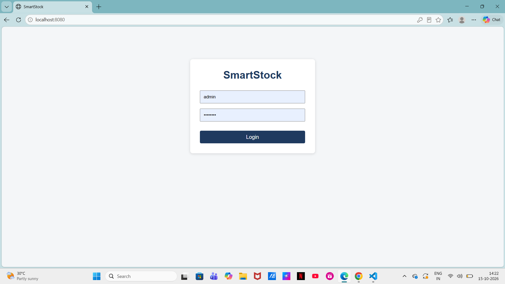
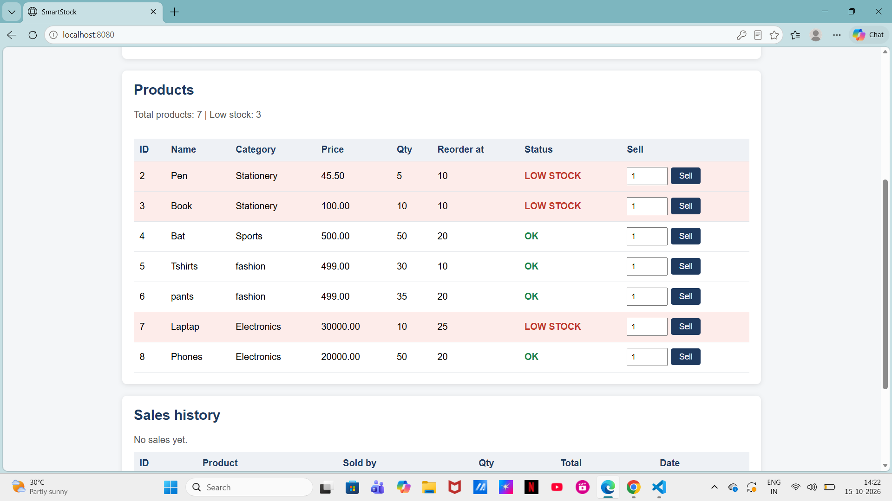
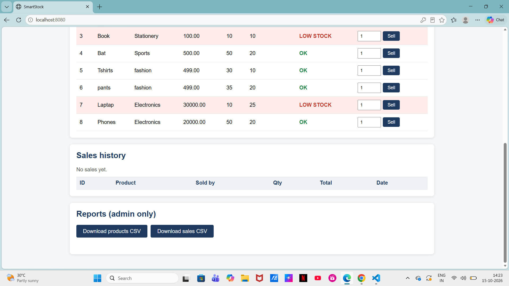

# SmartStock - Inventory & Sales Management System

A console-based inventory and sales management application built with core Java, JDBC and SQL Server.

## Features
- User registration and login with BCrypt-hashed passwords
- Role-based access (ADMIN / STAFF)
- Product management: add, view, update, delete
- Sales module: selling a product automatically reduces stock (JDBC transaction)
- Low-stock alerts based on a reorder level
- Reports: low-stock report and CSV export of products and sales

## Tech Stack
Java 21, Maven, JDBC, Microsoft SQL Server, jBCrypt, VS Code

## How to run
1. Install JDK 21+, Maven and SQL Server Express.
2. Run database.sql in SSMS to create the database and tables.
3. Copy db.properties.example to db.properties (same folder) and enter your own SQL Server password.
4. In the terminal, go to backend/smartstock-backend and run: mvn compile exec:java "-Dexec.mainClass=com.smartstock.WebApp"
5. Register a user, then make it admin in SSMS with: UPDATE Users SET role = 'ADMIN' WHERE username = 'yourname';

## Screenshots

## How it works
- `WebApp.java` starts a built-in Java HTTP server on port 8080 and opens the browser.
- The page (`index.html`) calls JSON endpoints such as `/api/login`, `/api/products`, `/api/sell` and `/api/export/products`.
- The API classes reuse the same DAO and service classes as the console app, so both interfaces share one database.
- Admin-only endpoints (CSV export) are checked on the server, not just hidden in the page.
